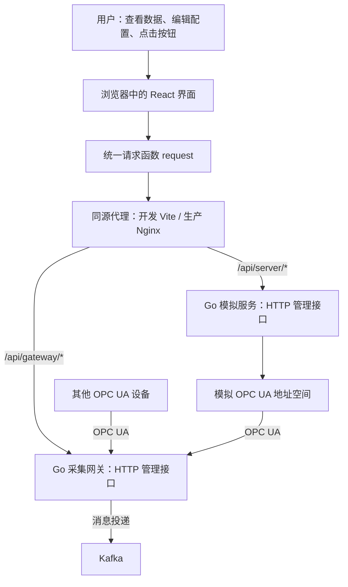
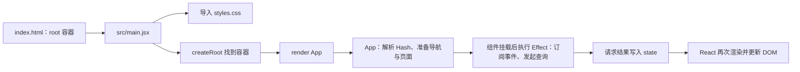
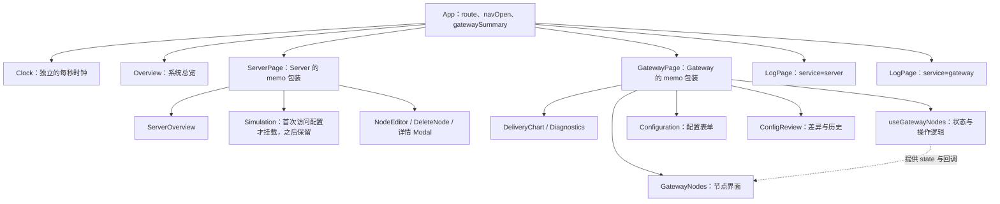
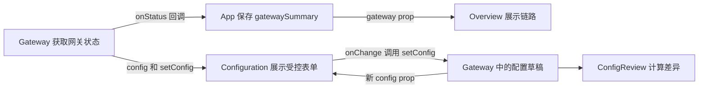
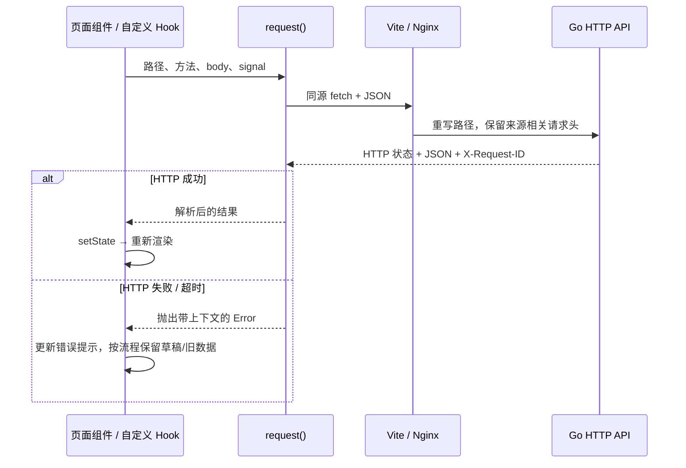
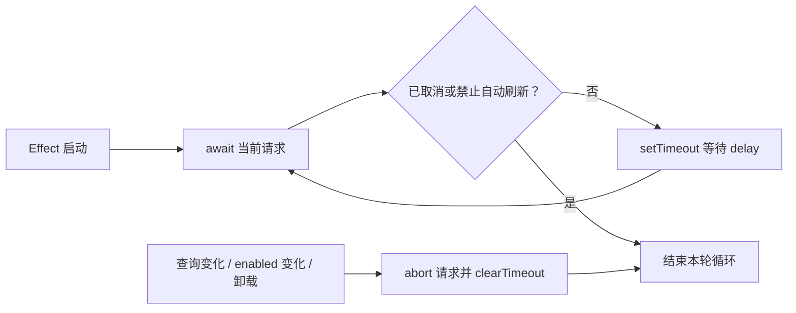
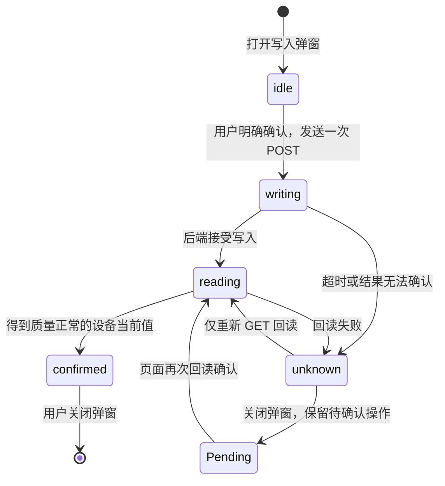

# 从 OPC Studio · Console 学习 React：前端分析与源码导读

> 面向刚接触前端和 React 的读者。分析依据是当前 `opc-console-ui` 源码，记录日期为 2026-10-25。配套中文注释覆盖 `src/` 全部源码，并延伸到测试、代理和启动脚本；注释以解释设计原因和数据流为主。

## 1. 先建立整体认识

这个前端是一个管理工作台：浏览器显示设备数据、收集用户输入，再通过 HTTP 请求让两个 Go 服务执行实际操作。模拟算法、OPC UA 协议连接、Kafka 投递和文件持久化均在后端完成。

React 在这里主要负责三件事：把页面拆成组件，用状态描述当前界面，随着状态变化更新显示。Vite 则负责开发服务、代码转换和生产打包；它不是 React 的组成部分。

当前项目可以概括为：**一个浏览器单页应用，10 个导航页面，两个后端接口入口，本地组件状态驱动界面。**



图中前端到两个后端的箭头表示管理 HTTP 请求；Go 服务之间的 OPC UA 采集，以及网关到 Kafka 的连接，不经过 React。界面上的链路图和投递趋势显示的是后端返回的结果。

## 2. 技术栈：每个工具解决什么问题

| 技术或工具               | 当前项目中的角色                                | 从哪里确认                              |
| ------------------------ | ----------------------------------------------- | --------------------------------------- |
| React / React DOM 19.3.1 | 定义组件、管理状态、把组件渲染到浏览器 DOM      | `package.json`、`src/main.jsx`          |
| JSX                      | 在 JavaScript 中描述界面结构，文件大多是 `.jsx` | `src/App.jsx` 等                        |
| Vite 8.3.4               | 开发服务器、热更新、JSX/TS 转换、构建、开发代理 | `vite.config.js`                        |
| 普通 CSS                 | 全局设计变量、布局、表格、表单和响应式样式      | `src/styles.css`                        |
| TypeScript 7.0.2         | 描述接口类型，检查 TS 契约代码                  | `src/api/contracts.ts`、`tsconfig.json` |
| Fetch / AbortController  | 请求 JSON API、取消过时请求                     | `src/api/client.js`                     |
| Playwright               | 在浏览器中操作页面并验证行为                    | `tests/`、`playwright.config.js`        |
| Prettier                 | 统一源码排版，不检查业务是否正确                | `package.json` 的格式命令               |
| Node.js                  | 运行 Vite、测试工具和本地启动脚本               | `scripts/start-local.mjs`               |

目前没有引入 React Router、Redux、Zustand、Axios、组件库或第三方图表库。路由使用浏览器 Hash；请求使用原生 `fetch`；投递趋势使用原生 SVG。这使基础机制比较容易追踪，但较大业务组件仍需分段阅读。

**类型检查的边界：**`tsconfig.json` 中 `allowJs: true` 允许纳入 JS，但 `checkJs: false` 没有严格检查现有 JS/JSX。`npm run typecheck` 通过不等于整个前端都有完整的静态类型保护。`contracts.ts` 也只覆盖当前定义的部分契约，不能把它理解为完整自动生成的全接口 SDK。

## 3. 启动时发生了什么



入口代码很短，适合首先阅读：

```jsx
import { createRoot } from 'react-dom/client';
import App from './App.jsx';
import './styles.css';

createRoot(document.getElementById('root')).render(<App />);
```

`document.getElementById` 找到已有 DOM 容器；`<App />` 是 React 元素，表示要渲染 App 组件。浏览器不能把原始 JSX 当普通 JS 执行，开发时和构建时由工具转换。

组件函数执行、计算并返回 JSX，称为“渲染”。一次组件渲染不等于销毁重建全部 DOM；React 会据此决定需要提交哪些 DOM 更新。事件订阅、网络请求和 `dialog.showModal()` 这类与外部系统交互的工作放在事件处理器或 Effect 中。

## 4. 完整源码地图

### 4.1 运行时代码

| 文件                                              | 主要职责                                   | 初学者重点                       |
| ------------------------------------------------- | ------------------------------------------ | -------------------------------- |
| `src/main.jsx`                                    | 挂载 App、导入全局 CSS                     | 入口、import、JSX                |
| `src/App.jsx`                                     | Hash 路由、导航、抽屉、跨区域网关摘要      | state、props、Effect、保留状态   |
| `src/shared.jsx`                                  | 轮询、可见性、时钟和通用 UI                | 自定义 Hook、清理、children、ref |
| `src/api/client.js`                               | Fetch 封装、超时和错误                     | async/await、JSON、异常          |
| `src/api/contracts.ts`                            | 接口类型及 `parse*` 运行时校验             | 类型与实际数据校验的区别         |
| `src/Server.jsx`                                  | 模拟节点快照、筛选分页、节点增删改查       | 表单、派生数据、列表、回调       |
| `src/Simulation.jsx`                              | 节点动态参数、业务规则、导入校验和运行轨迹 | 嵌套状态更新、草稿保护           |
| `src/Gateway.jsx`                                 | 自动连接、状态趋势和网关配置操作           | 父级状态、异步流程、三份配置     |
| `src/Configuration.jsx`                           | 网关连接与设置表单                         | 受控表单、动态属性路径           |
| `src/components/Icon.jsx`                         | 名称到 SVG 图形的映射                      | 展示组件、默认 props             |
| `src/features/overview/Overview.jsx`              | 全系统健康摘要、链路和关注事项             | props 数据共享、计算展示状态     |
| `src/features/server-overview/ServerOverview.jsx` | 模拟服务信息与节点类型分布                 | 无额外请求的展示组件             |
| `src/features/gateway-nodes/useGatewayNodes.js`   | 缓存分页、设备直读、安全写入与回读         | 业务自定义 Hook、状态机          |
| `src/features/gateway-nodes/GatewayNodes.jsx`     | 节点表格、操作和写入弹窗                   | 展示层与业务逻辑协作             |
| `src/features/gateway-config/ConfigReview.jsx`    | 草稿/文件/运行态差异和历史入口             | 递归纯函数、回调                 |
| `src/features/gateway-status/Diagnostics.jsx`     | 机组运行阶段与诊断信息                     | 数据映射、条件渲染               |
| `src/features/logs/LogViewer.jsx`                 | 两个服务共用的日志查询页面                 | 组件复用、防抖、稳定分页         |
| `src/styles.css`                                  | 全局样式与断点覆盖                         | Flex、Grid、CSS 变量、媒体查询   |

### 4.2 工程配套文件

| 位置                                 | 用途                                                    |
| ------------------------------------ | ------------------------------------------------------- |
| `package.json` / `package-lock.json` | 声明命令与依赖；锁文件固定安装结果，不适合手工逐行注释  |
| `vite.config.js`                     | 开发监听、后端代理、生产构建所用插件                    |
| `tsconfig.json`                      | 类型检查范围和编译选项；这是 JSON，不能直接插入普通注释 |
| `playwright.config.js`               | 独立测试端口、浏览器配置和测试服务启动方式              |
| `tests/fixtures.js`                  | 内存后端模型，拦截浏览器 API 请求并返回可控制的结果     |
| `tests/*.spec.js`                    | 自动操作页面，验证功能、冲突、回滚、布局等              |
| `scripts/start-local.mjs`            | CSV/TOML/二进制/端口预检，联合启动三个工程              |
| `deploy/nginx.conf`                  | 生产静态文件托管与 API 反向代理示例                     |
| `docs/`                              | 设计、日志功能、验证记录、预览图片和本学习报告          |

## 5. 组件树与页面路由



`useGatewayNodes` 在图中用于说明逻辑归属，它是 Hook，不是会生成 DOM 的子组件。`ServerPage`、`GatewayPage`、`LogPage` 是 `memo` 包装后的名称，并不是新的业务页面文件。

| 地址中的 Hash           | 页面                                  | 主要入口                                   |
| ----------------------- | ------------------------------------- | ------------------------------------------ |
| `#overview`             | 系统总览，也是空地址/无效地址的默认页 | `Overview`                                 |
| `#server/overview`      | 模拟服务运行总览                      | `Server` → `ServerOverview`                |
| `#server/configuration` | 模拟配置                              | `Server` → `Simulation`                    |
| `#server/monitor`       | 模拟节点数据监控                      | `Server`                                   |
| `#server/logs`          | 模拟服务日志                          | `LogViewer service="server"`               |
| `#gateway/overview`     | 网关运行总览                          | `Gateway` → `DeliveryChart`、`Diagnostics` |
| `#gateway/nodes`        | 网关设备节点                          | `Gateway` → `GatewayNodes`                 |
| `#gateway/connections`  | Kafka/OPC UA 连接配置                 | `Gateway` → `Configuration`                |
| `#gateway/settings`     | 采集参数和安全设置                    | `Gateway` → `Configuration`                |
| `#gateway/logs`         | 网关日志                              | `LogViewer service="gateway"`              |

旧地址 `#server` 仍映射到模拟节点监控。`location.hash = path` 触发 `hashchange`，监听器执行 `setRoute(currentRoute())`，进而让页面更新。Hash 的 `#` 后内容不会发送给服务器。

### 为什么切换页面后草稿还在

`App` 中的 Server、Gateway 和两个日志实例一直存在于稳定的 React 树位置。外层 `hidden` 影响显示，不卸载组件。部分组件在非激活时返回 `null`，表示自身暂不输出 DOM，其自身 Hooks 状态仍保留；它返回的子组件则可能被卸载。

`Simulation` 还有一层控制：`configurationVisited` 在首次进入配置页后变为 `true`。之前不挂载编辑器；之后通过 `hidden` 隐藏并保留它，编辑中的 `draft` 得以跨内部导航保留。

**隐藏不会自动停止 Effect。**项目通过 `active`、`observe` 和 `useVisible()` 控制请求。浏览器刷新会重新创建应用；本地 state 不是永久存储。`beforeunload` 只能提醒有未保存内容，不能替代后端持久化。React 根据组件在树中的位置保留状态，见 [React：保留与重置状态](https://react.dev/learn/preserving-and-resetting-state)。

## 6. React 基础概念，对照项目理解

### 6.1 组件与 props

组件通常是返回 JSX 的函数，名称首字母大写。props 是父组件传进来的输入参数：

```jsx
function Badge({ children, kind = '' }) {
  return <span className={`badge ${kind}`}>{children}</span>;
}

// 使用示例：kind 是命名 prop，标签之间的文字进入 children。
<Badge kind="good">已连接</Badge>;
```

不要直接修改 props。需要通知父组件时调用传入的回调。例如 `Configuration` 接收 `setConfig`，`NodeEditor` 接收 `onSaved`。这不是子组件直接控制父组件 DOM，而是父级状态发生更新后重新渲染。

### 6.2 state：会影响界面的组件记忆

```jsx
const [search, setSearch] = useState('');
```

`search` 是本次渲染看到的值；调用 `setSearch` 请求下一次渲染。它不会让当前函数中已经读取的旧变量即时变成新值。普通局部变量会随组件函数再次执行而重新计算，不能代替 state 保存输入内容。参见 [React：useState](https://react.dev/reference/react/useState)。

需要基于旧值计算新值时，项目经常使用函数式更新：

```jsx
setPaused((value) => !value);
setDraft((current) => ({ ...current, name: '新名称' }));
```

对象和数组更新应产生新引用。不能直接 `draft.name = '新名称'` 后期待 React 正确同步全部界面。嵌套内容要复制被修改的层：`Simulation.ruleChange()` 深复制目标规则，`updateProfile()` 复制节点数组及目标节点。

### 6.3 受控表单：输入由 state 决定

```jsx
<input value={search} onChange={(event) => setSearch(event.target.value)} />
```

用户输入 → `onChange` 取得值 → setter 更新 state → 下一次 JSX 的 `value` 显示新值。复选框使用 `checked` / `event.target.checked`。在当前项目中，配置表单大多采用这种模式。

`event.preventDefault()` 阻止浏览器的默认表单提交，避免整页刷新。表单内的非提交按钮要写 `type="button"`；未指定类型的 button 通常会提交表单。

### 6.4 本项目实际使用的 Hooks

| Hook/API      | 用途                                     | 可直接阅读的例子                         |
| ------------- | ---------------------------------------- | ---------------------------------------- |
| `useState`    | 保存影响显示的状态                       | `Server` 的搜索条件，`Simulation` 的草稿 |
| `useEffect`   | 连接事件、定时器、网络等外部系统，并清理 | `App` 的 `hashchange`，`usePolling`      |
| `useRef`      | 跨渲染保存可变引用，修改它不触发渲染     | 节点比较基线、请求控制器、DOM 引用       |
| `useMemo`     | 缓存计算结果                             | `Server.filtered`、`Simulation.nodeMap`  |
| `useCallback` | 缓存函数引用                             | `App.navigate`                           |
| `useId`       | 生成标签关联 ID                          | `Field`、模拟配置页签                    |
| `memo`        | props 不变时通常跳过父级引发的重渲染     | `ServerPage`、`GatewayPage`、`LogPage`   |

`memo` 不是 Hook，也不负责保存状态。`useMemo` 缓存结果，`useCallback` 缓存函数；都应服务于实际性能需求。`useRef` 与 state 的关键差别是：修改 `ref.current` 不会请求渲染，见 [React：useRef](https://react.dev/reference/react/useRef)。

Hooks 要在组件或自定义 Hook 的顶层调用，不能放在可能跳过的条件分支里。项目的 `if (!active) return null` 放在 Hooks 之后，保证调用顺序稳定。

### 6.5 Effect 和清理函数

`App` 中的 Hash 监听可以按以下结构理解：

```jsx
useEffect(() => {
  const listener = () => setRoute(currentRoute());
  window.addEventListener('hashchange', listener);
  return () => window.removeEventListener('hashchange', listener);
}, []);
```

挂载后订阅；卸载时清理。依赖变化时，React 会先清理旧 Effect，再建立新 Effect。空依赖数组表示此 Effect 不随 props/state 变化而重新订阅；不能把它理解成任何开发配置下都绝对只执行一次。开发模式启用 Strict Mode 时还可能额外检查建立/清理流程，当前 `main.jsx` 没有包裹 `<StrictMode>`。见 [React：useEffect](https://react.dev/reference/react/useEffect)。

依赖数组需要反映副作用依赖的值。当前 `usePolling` 用 ref 保存最新任务函数、用查询 key 重启请求，这是需要结合用途理解的封装，不能据此得出“Effect 依赖都可省略”的结论。

### 6.6 初学者常见语法

| 源码写法                                        | 含义                                           |
| ----------------------------------------------- | ---------------------------------------------- |
| `condition && <Alert />`                        | 条件成立才显示元素                             |
| `busy ? '正在保存' : '保存'`                    | 根据条件选择一个值                             |
| `nodes.map(node => <tr key={node.id}>...</tr>)` | 数组生成列表；key 标识同一数据项               |
| `snapshot?.nodes`                               | 对象为空时返回 undefined，避免直接取属性报错   |
| `node?.id ?? ''`                                | 仅在 null/undefined 时采用默认值，保留合法的 0 |
| `{ ...current, [key]: value }`                  | 复制对象并更新动态命名字段                     |
| `[...items].reverse()`                          | 先复制再反转，避免修改原数组                   |
| `async` / `await`                               | 用顺序形式等待异步结果                         |
| `try / catch / finally`                         | 分别处理成功、异常和无论结果都要做的收尾       |

列表 key 应尽量使用稳定 ID。当前节点与规则多使用业务 ID；机组表单、规则中的部分步骤/输出使用数组索引。这是现有实现需要理解的边界，若以后加入可重排且有内部状态的行组件，应重新考虑稳定标识。

## 7. 数据如何在组件之间流动



这体现了“把共享状态放到共同父组件”的模式。系统总览不再自己请求一份网关状态；配置表单与差异区域共享 Gateway 中的同一份草稿。官方进一步解释见 [React：管理状态](https://react.dev/learn/managing-state)。

| 状态属于谁                           | 保存哪些内容                               | 为什么放这里                   |
| ------------------------------------ | ------------------------------------------ | ------------------------------ |
| `App`                                | 路由、抽屉开关、网关摘要                   | 多个顶层区域需要使用           |
| `Server`                             | 全量节点快照、筛选、分页、弹窗目标         | 总览与监控共享节点数据         |
| `NodeEditor`                         | 单次编辑草稿、保存错误、忙碌               | 仅该弹窗需要，避免轮询覆盖     |
| `Simulation`                         | 配置基线、编辑草稿、运行进度               | 同时保护编辑并更新运行展示     |
| `Gateway`                            | 文件视图、草稿、运行态、状态趋势、机组选择 | 网关多个子页共享               |
| `useGatewayNodes` 调用所在的 Gateway | 节点分页、写入阶段、待回读操作             | 节点 UI 可卸载，流程状态仍保留 |
| 两个 `LogViewer` 各自                | 查询条件、结果、分页、详情                 | 服务之间筛选互不干扰           |

`filtered`、`dirty`、`canWrite` 等由已有状态计算得出的值，称为派生数据。通常不必再存成另一份 state，否则容易忘记同步。

## 8. 请求、轮询和取消

### 8.1 一个请求经过哪些层



模拟服务直接返回业务 JSON；网关通常返回 `{ code, message, data }`，`Gateway.api()` 取出 `data`。日志组件同时支持两种响应形状。

`fetch` 收到 HTTP 409/500 时不会自动抛异常，`request()` 根据 `response.ok` 主动抛错。错误可携带 `status`、`data`、`requestId`；部分只读错误设置 `retryable` 标志，但此封装没有实现自动重试。

浏览器只请求同源 `/api/server/*` 和 `/api/gateway/*`。例如 `/api/server/nodes` 由代理转成模拟服务的 `/api/nodes`。真实上游地址不写进前端产物，不发送 Authorization 头；代理保留 `Host`、`Origin`、`Sec-Fetch-Site`，配合后端写入来源检查。

### 8.2 为什么轮询不是简单 setInterval



如果每秒固定触发请求，而服务需要三秒才响应，就会出现多个未完成请求，旧结果还可能晚到。项目在请求完成后再安排下一次定时器，同一轮询会话内保持串行；因此“每 1 秒”实际是完成后再等 1 秒。

`usePolling(task, delay, enabled, key)` 中：`enabled` 决定自动运行，`key` 标识查询，`nonce` 支持手动刷新，任务 ref 保存最新函数，Effect 清理取消请求与定时器。手动刷新在自动暂停时仍可执行一次；调用者还可以在任务里追加 active/参数检查。

| 场景                 | 正常等待时间          | 主要启用条件                         |
| -------------------- | --------------------- | ------------------------------------ |
| 系统总览模拟健康摘要 | 5 秒                  | 总览激活、标签页可见                 |
| 模拟服务运行总览     | 5 秒                  | 服务页激活、标签页可见               |
| 模拟节点监控         | 1 秒，读取失败后 5 秒 | 监控页、未暂停、无编辑忙碌           |
| 模拟规则运行状态     | 2 秒                  | 配置页激活、已加载、无忙碌           |
| 网关首次管理连接     | 失败后等 5 秒         | 网关页或系统总览、尚未 ready         |
| 网关状态             | 5 秒                  | 网关页或系统总览、ready              |
| 配置运行态/历史摘要  | 5 秒                  | 连接/设置页、ready                   |
| 网关节点缓存         | 3 秒                  | 节点页、有机组、自动刷新、无操作忙碌 |
| 日志最新页           | 2 秒，失败后 5 秒     | 日志页、自动刷新、首页、筛选合法     |

`useVisible()` 检查浏览器标签是否隐藏，`active` 检查应用内部当前页，两者是不同维度。`useClock` 用 `setInterval` 更新本地时钟，没有网络请求，不会造成慢网请求堆积。

取消前端等待不能撤销服务端已经接受的写入，所以取消和超时都不能被当作“设备一定没执行”。

## 9. 三个业务流程，按步骤读代码

### 9.1 模拟节点的查询与编辑

1. `Server.read()` 请求全量节点并保存 `snapshot`，比较旧值记录变化及高亮。
2. `filtered` 根据搜索、类型、质量筛选并排序，最后每页显示 100 条。这是前端分页。
3. 点击编辑先读取单节点的最新内容和 revision，再挂载 `NodeEditor` 初始化草稿。
4. 修改 input 只更新弹窗草稿；提交时 PATCH 携带 revision。
5. 成功后通知父组件、关闭弹窗、刷新快照。409 时显示冲突，保留当前输入。

FLOAT 等节点值保留字符串，不能为了“方便”统一转换成 Number。OPC UA 质量码的最高两位表示 Good/Uncertain/Bad；不能直接用数值的真假来判断正常。

### 9.2 模拟配置：保存基线、编辑草稿与实时进度

`Simulation.load()` 并行读取节点目录和模拟配置，保存服务端 `document`，再复制 `document.config` 成为 `draft`。用户只编辑 draft；`runtime` 每两秒独立更新。

规则、节点和输出是嵌套对象。`change()` 处理顶层或规则数组增删，`ruleChange()` 深复制一个规则再修改步骤/输出，`updateProfile()` 只复制一个节点参数对象。筛选结果保留原始数组 index，防止把搜索结果第一行误改成完整目录第一项。

导入经历“文件大小检查 → JSON 语法解析 → 本地结构/节点 ID 校验 → 后端业务校验 → 载入草稿”。它不会直接保存。校验成功也不会应用；只有保存才 PUT 配置并携带 revision。

后端最近 128 条运行轨迹属于内存记录；当前表格反转副本后展示最近 50 条。不要把实时轨迹或历史进度合并回编辑草稿。

### 9.3 网关：文件、草稿与运行配置

| 对象            | 含义                                                       | 更新时机                                   |
| --------------- | ---------------------------------------------------------- | ------------------------------------------ |
| `view.config`   | 最近读到的文件内容基线，view 还含 revision/inSync 等元信息 | 首次加载、明确重读或保存成功               |
| `config`        | 用户正在编辑的草稿                                         | 表单修改、历史版本载入、明确重读或保存成功 |
| `runningConfig` | 后端当前运行内容                                           | 配置审阅轮询，避免覆盖草稿                 |

| 按钮       | 行为                                                        |
| ---------- | ----------------------------------------------------------- |
| 重新读取   | 读取当前文件，可能经确认后替换未保存草稿                    |
| 重载文件   | 让 Go 将磁盘配置重新应用到运行态，再读取文件视图            |
| 校验配置   | 验证草稿并显示预计影响，不保存                              |
| 仅保存     | PUT `apply: false`，更新文件，运行连接继续使用原配置        |
| 保存并应用 | PUT `apply: true`，保存后切换运行态                         |
| 载入历史   | 用历史内容建立草稿，revision 取当前文件，后续仍需校验和保存 |

409 表示文件版本已变化；热应用失败还可能携带 `fileRestored` 回滚结果。两种失败都应保留用户草稿，不能用后台轮询的配置直接替换它。

## 10. 设备节点写入：必须理解的状态机



关键入口都在 `useGatewayNodes`：

- `refreshCache`：默认轮询 `source=cache`，每页 25 条，使用后端分页。
- `readDevice`：明确请求 `source=device`，单独管理取消信号，并核对最新查询 key。
- `openWrite`：记录目标机组、节点和写前值，只有 `canWrite` 时允许打开。
- `write`：只允许 idle 提交一次 POST，接受后立即回读，不自动重发。
- `verify`：GET 单点实际当前值，校验节点身份、观测时间和质量。
- `verification`：保存尚需确认的操作，即使弹窗关闭也继续保留。

读取到当前值，尤其在原写入未知时，并不能证明原写入一定成功。设备联动还可能继续改变值。因此界面分别表达“写入已接受”“已读取当前值”“原写入结果仍未知”。

`canWrite` 综合只读标志、状态是否过期、节点页新鲜度、忙碌状态和待确认操作。缓存时间/最近观测时间用于判断数据有效性，不能仅凭源时间没变化就判定设备离线。暂停自动刷新较久时也会限制写入。

重新发现同样是异步流程：接受请求 → 重建会话/浏览目录 → 新目录出现 → 等待新快照确认 → ready。收到启动响应不能直接显示整个采集链路已经恢复。

## 11. 日志页面为什么比普通表格复杂

日志一直增长，如果只用 offset 翻页，新插入的数据可能使相同页码发生位移。`LogViewer` 将首页得到的 anchor 作为后续历史页上界，同时固定时间查询边界，减少翻页时重复或漏项。

`instanceId` 标识后端进程；进程重启后旧游标失效，回到最新页。内存环形缓存淘汰旧记录后，如果 offset 已超过新总数，就调整到仍然有效的最后一页。

自动刷新只针对最新页，历史页保持当前窗口。查询条件产生 key，响应返回时还要核对它是否仍然是当前 key。搜索输入用 350ms 防抖，不让每次按键都发请求。两个服务共用组件逻辑，但各有自己的状态实例。

日志和节点名称通过 JSX 普通文本插值显示，即使内容长得像 HTML，也不应该作为代码执行。测试夹具包含类似 `<script>` 的名字，正是为了验证文本显示行为。

## 12. CSS、响应式和可访问性

CSS 从根变量、桌面工作空间、通用 UI、业务表单逐步组织到媒体查询和日志区域。`className="button primary"` 表示同一元素匹配 `.button` 与 `.button.primary` 两类规则，不是 React 专有样式语法。

| 样式机制                          | 作用                               | 项目示例                    |
| --------------------------------- | ---------------------------------- | --------------------------- |
| CSS 变量                          | 统一颜色、间距相关配置             | `--line`、`--sidebar-width` |
| Flex                              | 一行中的按钮、工具栏、导航排列     | `.toolbar`、`.actions`      |
| Grid                              | 指标、表单、总览多列排布           | `.metrics`、`.fields-grid`  |
| `minmax(0, 1fr)` / `min-width: 0` | 允许列和内容收缩，避免撑破布局     | 面板与网格                  |
| 区域滚动                          | 宽表格只在自身滚动，页面整体不溢出 | `.table-scroll`             |
| 媒体查询                          | 根据可用宽度调整布局               | 1200 / 1050 / 900 / 600px   |
| `:focus-visible`                  | 让键盘用户看见焦点位置             | 按钮、输入框、链接          |

900px 是抽屉切换的重要边界，CSS 与 `App.matchMedia` 需要保持一致。打开抽屉锁定背景滚动，支持 Escape 关闭和焦点返回，并让 Tab 在抽屉内循环。

`Field` 用 `useId` 关联 `<label>`、输入框和帮助文字；`Modal` 使用原生 `<dialog>`；错误提示使用 `role="alert"`。这些属性既服务读屏与键盘操作，也让 Playwright 可以按用户看见的名称查找元素。

## 13. 验证与部署如何协作

### 13.1 现有测试覆盖地图

| 文件                         | 重点                                                     |
| ---------------------------- | -------------------------------------------------------- |
| `console.spec.js`            | 节点 CRUD、文本转义、冲突保留、配置回滚、只读、自动连接  |
| `navigation.spec.js`         | 分组导航、模拟草稿保留、直达地址、旧书签                 |
| `gateway-connection.spec.js` | 无令牌自动连接、不可用后的恢复                           |
| `optimizations.spec.js`      | 写后回读、未知写入不重发、缓存与直读、历史、导入、大目录 |
| `logs.spec.js`               | 两服务独立筛选、分页锚点、重启恢复、暂停与移动端         |
| `redesign.spec.js`           | 系统总览状态、快捷入口、移动导航                         |
| `simulation-layout.spec.js`  | 不同视口下业务规则表单是否可读可编辑                     |
| `live.spec.js`               | 显式 `LIVE_APIS=1` 才启用的真实后端验收                  |
| `live-collection.spec.js`    | 显式 `LIVE_COLLECTION=1` 才启用的真实采集/写入验收       |

普通测试通过 `mockAPIs(page)` 拦截 `**/api/**`，读取/写入发生在测试内存模型中。它们可以验证前端交互，但不能代替 Go 对协议、Kafka 和真实文件持久化的测试。两个 live 用例默认跳过；日常学习不需要开启。

不要把测试里的示例 Broker 地址当作“测试会连接 Kafka”。普通测试由拦截器返回 JSON，示例地址只是数据。直接 `npm run dev` 则连接配置的真实后端代理，不会自动启用测试 Mock。

### 13.2 常用命令与职责

在 `opc-console-ui` 目录执行：

```sh
# 已装依赖时可直接启动；首次安装使用 npm ci，需要 Node.js >= 22.12。
npm run dev

# TS 契约检查；build 内也会先执行这一项。
npm run typecheck

# 代码格式检查、生产构建、普通浏览器回归。
npm run format:check
npm run build
npm test

# 学习导航与草稿行为时，可仅运行这组已有用例。
npm test -- tests/navigation.spec.js
```

构建输出到 `dist/`。生产 Nginx 提供这些静态文件，并将两个 `/api/` 前缀反向代理到 Go 服务；运行环境不必安装 Node.js。`npm run preview` 用于本机构建预览，默认端口 4173。开发端口默认 5173，测试默认 15174。

`start:local` 会启动两个 Go 服务及 Vite，并保留网关文件中的地址；它不是 React 入门的必需步骤。普通回归不应连接生产 Kafka 或真实现场设备。联合脚本不会启动 Kafka，也不会终止已占用端口的其他进程。

## 14. 建议的阅读与练习顺序

先学通一条小的数据流，再读复杂业务，效果通常比按文件大小依次阅读更好。

| 阶段                | 阅读范围                                      | 练习                                   | 判断自己是否理解                          |
| ------------------- | --------------------------------------------- | -------------------------------------- | ----------------------------------------- |
| 1. 页面从哪里来     | `main.jsx` → `App.jsx` → `Badge` / `Metric`   | 修改一个展示标题或提示，再还原         | 能指出容器、组件、props 与 JSX 的关系     |
| 2. 表单与状态       | `Server` 的 search、筛选和暂停按钮            | 跟踪一次输入从 onChange 到表格更新     | 能解释 state 为什么比普通变量适合保存输入 |
| 3. 数据与生命周期   | `request` → `usePolling` → `Server.read`      | 阅读网络请求，切页观察查询停止         | 能说明 Effect 的建立与清理分别做什么      |
| 4. 编辑与不可变更新 | `NodeEditor` → `Simulation.updateProfile`     | 在本地草稿修改一个字段，切页后回来观察 | 能指出基线、草稿、revision 的区别         |
| 5. 组件协作         | `Gateway` → `Configuration` / `ConfigReview`  | 跟踪一项机组配置修改如何变成差异行     | 能画出 props 向下、回调上报的数据流       |
| 6. 复杂异步业务     | `useGatewayNodes` → `GatewayNodes` → 相关测试 | 阅读并运行未知写入回归用例             | 能解释 POST 一次与 GET 回读多次的区别     |
| 7. 自主小改动       | `LogViewer` 或小展示组件                      | 选择一个不影响 API 的小展示需求        | 能定位状态、样式与需要运行的测试          |

推荐第一条主线是：**入口 → 导航 → 一个搜索框 → 一个列表 → 一个编辑弹窗 → 一次 API 保存**。等这条线清楚后，再研究模拟规则和设备写入流程。

学习时先回答三个问题：这段数据属于哪个组件？它改变后谁会重新渲染？这次异步结果回来时，用户是否可能已经换了页面或查询？

## 15. 当前实现的优点与阅读难点

优点是数据所有者比较明确，配置基线与草稿分开，串行轮询和取消有公共封装；节点业务 Hook 与展示组件已经分离；浏览器测试覆盖了冲突、未知写入等重要业务边界。

阅读难点主要来自 `Server`、`Gateway`、`Simulation` 和 `LogViewer` 同时承担较多状态和界面结构。初学时按本报告给出的数据流分段阅读，不必一次记住整个文件。顶层页面保留状态的代价是隐藏组件仍在内存里，因此理解 active 和请求暂停非常重要。

后续重构可以逐步拆分大型组件、为更多 JS/JSX 增加类型检查，或在可重排行中引入更稳定的标识。这些是学习后的演进方向，本次注释没有实施这些结构改动，也没有改变接口或设备操作逻辑。

## 16. 后续查阅入口

- [React：描述用户界面](https://react.dev/learn/describing-the-ui)
- [React：添加交互](https://react.dev/learn/adding-interactivity)
- [React：管理状态](https://react.dev/learn/managing-state)
- [React：useState](https://react.dev/reference/react/useState)
- [React：useEffect](https://react.dev/reference/react/useEffect)
- [React：useRef](https://react.dev/reference/react/useRef)
- [React：useMemo](https://react.dev/reference/react/useMemo)
- [React：保留与重置状态](https://react.dev/learn/preserving-and-resetting-state)
- [本项目运行说明](../README.md)
- [本项目日志功能说明](./log-viewer.md)
- [工作区源码与 API 地图](../../PROJECT_MAP.md)

本报告中的工程行为以当前源码为准；React 基础概念参考上述官方文档。

## 17. 本次注释的验证记录

2026-10-25 在本工程目录完成以下检查：

| 检查                                        | 结果                              |
| ------------------------------------------- | --------------------------------- |
| `npm run format:check`                      | 通过                              |
| `npm run build`（包含 `npm run typecheck`） | 通过                              |
| 普通 Playwright 回归                        | 34 通过，2 个真实服务用例默认跳过 |
| 30 个 JS/JSX/TS 文件注释前后语法树对比      | 去掉注释和源位置元信息后相同      |
| CSS 语法树与 Nginx 指令对比                 | 去掉注释和源位置元信息后相同      |
| 原有 `index.html` 工作区修改                | 保持原样                          |

浏览器回归显式取消了 `LIVE_APIS`、`LIVE_COLLECTION` 和 `UI_TEST_URL` 环境变量，使用独立测试服务及内存 API 夹具；本次没有执行真实设备或 Kafka 联调，也没有新增依赖或修改 API 契约。

## 18. 更细的中文注释应该怎样阅读

本轮注释按下面的层次补充，建议先读完整个函数，再沿对应层次核对细节：

1. **组件/函数入口**：说明每个 props 或参数从哪里来、负责什么，以及返回值交给谁使用。
2. **状态与引用**：逐组说明 state 的显示含义，区分基线、草稿、运行态、查询身份和 DOM 引用。
3. **事件处理过程**：解释输入转换、请求前检查、成功后的同步、异常保留和 finally 收尾。
4. **Effect 与异步边界**：解释依赖变化、定时器清理、取消信号，以及过时响应为什么不能覆盖新查询。
5. **JSX 区域**：使用 JSX 注释标注导航、受控表单、列表、条件渲染、弹窗和动作区域。
6. **契约字段**：补充 101 个接口字段的中文含义、单位、可选性，以及不同时间/版本字段的区别。
7. **CSS 与测试**：解释布局机制和测试场景的目的，而不只把英文语法逐字翻译成中文。

例如，阅读设备节点功能时，可以先读 useGatewayNodes 的参数和状态说明，再跟踪
openWrite → write → verify，最后回到 GatewayNodes 对照每个阶段出现的按钮和提示。
看见注释中的“保留”“取消”“只读”“待确认”时，都可以继续找到具体状态或条件，核实它实际约束的行为。

本轮仅补充学习说明与中文注释，业务标识符、接口字段和命令保留原有英文，以便对照协议及工具。

### 本轮验证（2026-10-26）

- 格式检查、TypeScript 契约检查与生产构建通过。
- 普通浏览器回归：34 项通过；2 项需要真实服务的用例按默认设置跳过。
- 对 30 个 JS/JSX/TS 文件和 1 个 CSS 文件进行语法树对比，去掉注释、位置元信息及 JSX 排版空白后结构一致。
- 原有 index.html 工作区内容保持原样；没有新增依赖或更改接口契约。
